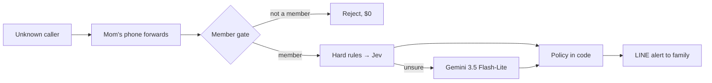

# ใครอะ · Krai-A — AI that answers scam calls for the people you love

**Team SORNKan** · Google Cloud AI Builder Cup 2026 (BFSI: intelligent risk & fraud)

Online and phone fraud cost Thais ฿24.9B in 2025. People over 60 are 8% of victims but lose 28.5% of
the money (Jan–Aug 2026). Krai-A forwards Mom's unknown calls to a calm Thai AI receptionist that judges every sentence,
hangs up on scammers, and alerts the family on LINE before any money moves.

- **Live:** https://krai-a.com
- **Demo:** https://krai-a.com/demo.html. Play 5 pre-recorded calls from a real engine run
  (3 scams, 1 real caller, 1 unsure), or **talk to the AI live** in a 2-minute Gemini Live session.

## How it works

1. **Forward once.** A family member signs up with a phone OTP, adds Mom and Dad, and dials one
   GSM forwarding code on each phone (`**61*` unanswered, `**67*` busy, `**21*` all calls).
   Nothing gets installed on the elder's phone.
2. **Central-number gate.** There is one shared AI number per country. A call that wasn't forwarded
   from an active member's phone is rejected unanswered, so it costs $0.
3. **Thai AI receptionist.** It answers with a recording notice and asks who is calling and why.
4. **Per-turn typed judgment.** For every caller turn:
   - Hard rules catch OTP and app-install demands. A hit is only a candidate until TypeSafe Jev confirms it.
   - **TypeSafe Jev** (`jev-latest`) runs one typed request: a verdict Choice (SCAM / LEGIT / UNSURE)
     plus 9 signal Nouls (authority, urgency, secrecy, transfer, OTP, app install, identity probe,
     injection, callback). This takes about 0.3 s.
   - Only when Jev is unsure does **Gemini 3.5 Flash-Lite** decide. It returns a structured JSON
     verdict and a Thai + English reason. Gemini can raise suspicion but can never clear a call Jev flagged.
   - Thresholds and actions (hang up, take a message, keep asking) live in code, not in a prompt.
5. **Guarded voice.** Gemini 3.5 Flash-Lite drafts each spoken line. Jev checks that the line never
   complies with a demand, reveals the owner, or fakes a bad line before Twilio speaks it.
6. **The family knows.** A LINE card goes only to the LINE account the member linked: red for a
   scam (the AI hung up), green for a message with a callback number, amber when the family should decide.



## Stack

| Layer | What we use |
|---|---|
| Runtime | **Cloud Run** (one Node.js ≥ 20 service: site, member app, voice webhooks, live WebSocket) |
| Judgment | **TypeSafe Jev** `jev-latest` for typed per-turn verdicts and signals; hard rules in code |
| Language | **Gemini 3.5 Flash-Lite** for escalation verdicts, reasons and receptionist lines |
| Live demo | **Gemini 3.8 Live** native audio (voice Achernar), 2-min cap, reCAPTCHA-gated |
| Voice | **Gemini 3.8 Flash TTS** pre-renders demo calls and fixed phone lines; Twilio Google Chirp3-HD for live replies |
| Data | **Firestore** (members, calls, transcripts) · **Secret Manager** (all keys) |
| Abuse | **reCAPTCHA Enterprise** + per-IP and daily caps |
| Telephony / alerts | Twilio Voice (signed webhooks) · LINE Messaging API + LIFF |

## Measured results

Final eval run, 12 Oct 2026, production config (Jev `jev-latest` + Gemini 3.5 Flash-Lite).
Dataset: 57 calls (29 scam · 19 legit · 9 unsure; 51 Thai, 6 English), 118 judged turns.

| Metric | Result |
|---|---|
| Scams caught | **29 / 29** (95% CI 88–100%), all hung up by policy |
| Legit callers flagged as scam | **0 / 19** |
| Exact class | 94.7% (54/57). The other 3 ended on a pre-agreed safe verdict |
| Judge latency per caller turn | median **0.30 s** · Jev-only 0.29 s · with Gemini escalation 1.4 s · p95 1.6 s |
| Turns decided without Gemini | 70% |
| Prompt-injection calls | 3 / 3 caught |
| Text-AI cost per call | ≈ ฿0.03 (judge, reply and guard; excludes speech and telephony) |
| Demo scripts | 5 / 5 |

> **Caveat:** the dataset is team-written scripts (`app/test/fixtures/eval-calls.json`), not real
> recordings with speech-to-text errors, and n is small. Real-traffic accuracy comes from a pilot.
> To reproduce, run `cd app && npm run eval`. It needs the Gemini and TypeSafe keys.

## Privacy (Thailand PDPA) and security

- **Transcripts, not audio,** on real calls. They are auto-deleted after 7 days for real callers,
  90 days for unsure calls and 365 days for scams (kept as evidence).
- Members can delete any call, erase their account (`DELETE /api/me`) or withdraw consent
  (`/withdraw.html`, with its own OTP and captcha).
- Alerts go only to a LINE account the member linked themselves. Member data APIs are closed to the public.
- The live demo never stores voice or transcripts. Every phone call opens with a recording notice.
- No caller text in server logs, a Content-Security-Policy, Twilio signature checks on every
  `/voice/*` request, and keys in Secret Manager only (never sent to the browser).
- Caller speech is treated as data, never instructions. Unsure means UNSURE plus a transcript, never a guess.
- `node scripts/check-public.js` blocks private paths and secrets from this public repo.

## Quick start (no keys needed)

```sh
cd app
npm install
npm test
node src/server.js        # http://localhost:8080
```

Without keys the app runs in offline rules mode. Hard rules and keyword rules judge, the receptionist
uses canned lines, the demo page replays the pre-recorded calls, and live talk is disabled.
To enable live AI, copy `app/.env.example` to `app/.env` and fill in `GEMINI_API_KEY` and
`TYPESAFE_API_KEY`. Twilio, LINE, reCAPTCHA and Stripe are optional.

## Scripts (run from `app/`)

| Command | What it does |
|---|---|
| `npm test` | node:test suite: judge, gates, privacy, billing, live voice and more. No network |
| `npm run eval` | Runs the 57-call eval against the real engine and writes `summary.md` (`--persona`, `--only`, `--repeat`) |
| `node scripts/render-demo.mjs` | Records the 5 demo calls once from the real engine and voices them with Gemini TTS (needs ffmpeg) |
| `node scripts/judge-smoke.mjs` · `node scripts/live-smoke.mjs` | Quick live checks of the judge and the Gemini Live session |

Deploy with `deploy-cloudrun.sh` (Cloud Run, `asia-southeast1`). Code lives in `app/src` (the judge is in
`app/src/judge/`), tests and the eval dataset in `app/test`. Ops, env vars, LINE/Twilio setup and the API
surface are in **[app/README.md](app/README.md)**.

## Known limitations

- **Two voices on real calls.** Fixed lines use Gemini TTS (Achernar). Live replies use Twilio's
  Google Chirp3-HD voice (Aoede).
- **Scripted eval.** Results above come from team-written calls, not live traffic.
- **Central Thai number pending.** Real-call signup is a waitlist until the shared number and carrier
  forwarding tests are done.
- **Payments in test mode.** Stripe runs in test mode, and no real charges are made.

## License

MIT, see [LICENSE](LICENSE).
