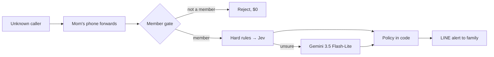

# ใครอะ · Krai-A — ops & developer guide

Team SORNKan's AI call screener for Thai phone scams. Project overview, measured results and
limitations are in the [root README](../README.md). This file covers running and operating the app.

**Flow (v2).** A protected phone forwards unknown calls once (`**61*` unanswered, `**67*` busy,
`**21*` all) to **one central AI number per country**. Calls not forwarded from an active member
are rejected unanswered ($0). A Thai AI receptionist answers. On every caller turn:
1. Hard rules flag OTP and app-install demands as candidates.
2. **TypeSafe Jev** (`jev-latest`) returns one typed verdict (SCAM / LEGIT / UNSURE) plus 9 signals.
3. **Gemini 3.5 Flash-Lite** decides only when Jev is unsure, and writes the reasons and the receptionist's lines.
4. The policy in code hangs up, takes a message, or keeps asking.

The family gets a LINE card. Transcripts are stored, not audio.

**Demo surface.** `/demo.html` replays 5 calls recorded once from the real engine and voiced with
**Gemini 3.8 Flash TTS**, so visitors trigger zero API calls. "Talk to the AI" opens a 2-minute
**Gemini 3.8 Live** native-audio session (reCAPTCHA plus per-IP and daily caps).

One Cloud Run service serves the site, the member app (`/start.html`, `/dashboard.html`, LINE LIFF),
the Twilio voice webhooks, the demo and the live WebSocket. Product pages are Thai-first with an EN toggle.

## Quick start (2 minutes, no keys)

```sh
cd app
npm install
npm test
npm start          # http://localhost:8080
```

- `/demo.html`: the 5 recorded calls play from static files, with no keys and no network.
  "Talk to the AI" shows *unavailable* until a Gemini key is set.
- `/start.html` → `/dashboard.html`: sign up with a phone OTP. Outside production, mock SMS shows
  the code in the browser. Add Mom and Dad and follow the forwarding instructions.
- **Offline rules mode.** With no keys, or `AI_OFFLINE=1`, the judge runs on hard rules plus
  keyword rules (`engine: rules-fallback`) and the receptionist uses canned Thai lines. `npm test`
  always runs this way unless `AI_LIVE_TESTS=1`.

## Live AI mode (Jev + Gemini)

```sh
cp .env.example .env   # set GEMINI_API_KEY and TYPESAFE_API_KEY
npm start
```

`GET /api/status` reports `engineStatus.mode`: `live` means Jev and Gemini are both up, and
`degraded` means Gemini plus rules without Jev. Every verdict reports its `engine`
(`rule` / `jev` / `gemini` / `rules-fallback`), so you can see what decided.
Gemini key: https://aistudio.google.com/apikey. Use a paid-tier project for anything that carries
strangers' voices, such as the live demo. The TypeSafe key comes from typesafe.ai.

## Real phone loop (Twilio)

1. Twilio Console → buy a number, upgrade from trial.
2. Phone number → Voice → "A call comes in" webhook `POST https://krai-a.com/voice/incoming`
   and "Call status changes" `POST https://krai-a.com/voice/status` (events: completed,
   no-answer, busy, failed). The status callback is required: it settles calls whose
   caller hangs up mid-call (verdict + owner alert + billing). Use the same host as
   `PUBLIC_BASE_URL` — every `/voice/*` request must carry a valid X-Twilio-Signature.
3. Set `TWILIO_ACCOUNT_SID`, `DEMO_NUMBER` in env, redeploy.
4. From your phone dial `**21*<ai-number>#` (all calls) or `**61*<ai-number>#`
   (unanswered only). Call your own number from another phone — the AI answers.

Production note: the AI number must be Thai, otherwise owners pay IDD rates on
every forwarded leg.

## Voice

- **Public demo = pre-rendered.** `node scripts/render-demo.mjs` (run locally,
  needs ffmpeg) plays each script in `src/demoScripts.js` through the real
  engine once — `judgeTurn` after every caller line, `personaReply` for the AI —
  voices every line with Gemini TTS (`gemini-3.8-flash-tts`; AI = Achernar),
  checks each clip against its subtitle (transcript + Jev), and writes
  `public/demo/scenarios.json` + `public/demo/audio/*.mp3`. Visitors replay
  static files: zero API calls. Clips are cached by
  sha1(model|voice|style|text) in `agent-temp/tts-cache`, so a re-run only pays
  for changed lines. `--dry` prints the conversations without audio.
- **Phone prompts.** The same script renders the fixed phone lines (record
  notice, greeting, gather, no-speech, 3 closings) as 8 kHz mp3 in
  `public/voice-audio/` (`--prompts-only`). `src/twilio/voice.js` `<Play>`s a
  clip only while its text still equals the live string, else falls back to
  `<Say>` — re-render after changing any of those texts.
- **Known limitation: two voices on real calls.** Fixed lines are Gemini
  Achernar; dynamic replies use Twilio `<Say>` with
  `Google.th-TH-Chirp3-HD-Aoede` (Twilio has no Achernar), so a caller hears a
  slightly different voice for generated sentences. Fix later by streaming
  Gemini TTS into the call (Media Streams).
- `GET /api/tts?call=&turn=` (`src/ttsRoutes.js`) streams Gemini TTS for a
  stored demo AI line (~1 s to first audio); off unless `DEMO_TEXT_API=1`.

## LINE Login + LIFF setup (alerts inside LINE)

App flow: member opens the LIFF page inside LINE -> LINE Login verifies the ID token ->
if the LINE id is unknown the page asks for phone OTP first, then binds it to that
phone account (POST /me/link-line). Next opens log straight in.

Steps the USER must do in the LINE Developers Console (https://developers.line.biz/console/):

1. Create a Provider (or reuse one) -> create a **LINE Login** channel (must be
   LINE Login type, not Messaging API — only Login channels mint ID tokens).
2. Channel **App settings** tab: copy the **Channel ID** -> env LINE_LOGIN_CHANNEL_ID.
3. Same tab -> **Linked LIFF app** -> Add -> new LIFF app: Size **Full**,
   Endpoint URL https://<your-host>/liff.html, Scopes **profile** + **openid**.
   Copy the **LIFF ID** (<digits>-<id>) -> env LINE_LIFF_ID.
4. For push alerts (optional): create/use a **Messaging API** channel, copy its
   Channel access token -> LINE_CHANNEL_ACCESS_TOKEN and Channel secret ->
   LINE_CHANNEL_SECRET; set NOTIFY_ADAPTERS=console,line.
5. Redeploy / restart with the env set, then open the LIFF URL inside LINE to test:
   first open asks phone OTP and links; later opens skip straight to settings.

Env vars (see .env.example): LINE_LOGIN_CHANNEL_ID, LINE_LIFF_ID,
LINE_CHANNEL_SECRET, LINE_CHANNEL_ACCESS_TOKEN, LINE_DEFAULT_TO (push only).

## Deploy (live: https://krai-a.com, Google Cloud Run)

```sh
DRY_RUN=1 PROJECT_ID=krai-a ./deploy-cloudrun.sh   # print every command, run nothing
PROJECT_ID=krai-a ./deploy-cloudrun.sh             # deploy (repo root; needs gcloud + curl)
JUDGING=1 PROJECT_ID=krai-a ./deploy-cloudrun.sh   # judging window: 1 warm instance, CPU always on
```

One Cloud Run service: marketing site + member app + Twilio voice webhooks
+ live demo. The script deploys a new image with **targeted** env updates
(`--update-env-vars`; the rest of the live env is kept) and secrets from
Secret Manager only (it stops and prints the `gcloud secrets create` command
for any missing one — `typesafe-api-key`, `trial-tombstone-secret`, …). It runs
a single instance (`--max-instances 1 --session-affinity --timeout 900`:
snapshots, rate limits and live sessions are in-memory), prints the previous
revision + the rollback command, and smoke-tests `/api/status`, `/api/members`
(404), `/demo.html` and the CSP header. After a deploy, check the logs for
`[csp]` and `bad twilio signature` lines.

## Pages

| Path | Purpose |
|---|---|
| `/` | one-page site: hero, how it works (`#setup`), who it protects (`#family`), trust, FAQ, price (TH/EN) |
| `/demo.html` | demo stage: 5 recorded calls + "Talk to the AI" (2-min Gemini Live) |
| `/pricing.html` | pricing v2 (rendered from `GET /api/plans`) |
| `/start.html` | sign up / log in with phone OTP (`?plan=` preselects) |
| `/dashboard.html` | member app: Home · My people (protected phones, forwarding codes) · Settings (plan, LINE, account erasure, cancel) |
| `/liff.html` | the same member app inside LINE (LIFF), incl. linking the family's LINE for alerts |
| `/withdraw.html` | PDPA consent withdrawal for protected people (own OTP purpose + captcha) |

Retired v1 pages (`/features.html`, `/how-it-works.html`, `/family.html`, `/stats.html`) 301-redirect to
the one-page site (`src/redirects.js`).

## Plans (pricing v2)

Source of truth: `PLANS`, `GIFTS`, `ADDON_SEAT`, `TOPUP_PACKS` in `src/store.js`, served by `GET /api/plans`.

| Plan | TH / month | TH / year | EN (USD) / month | Protected phones | Calls / minutes per month | LINE watchers |
|---|---|---|---|---|---|---|
| Solo (`solo-99`) | ฿99 | ฿890 | $3 | 1 | 30 / 60 | 3 |
| Family (`family-199`) | ฿199 | ฿1,790 | $6 | 3 | 90 / 180 pooled | unlimited |

- **Extra phone on Family:** +฿59 / $2 per month each, with its own 30 calls / 60 min. Max 5 protected phones per household.
- **1-year gift:** ฿990 (Solo) / ฿1,990 (Family). One-time payment, no auto-renew.
- **Top-ups:** ฿29 (5 calls / 10 min) · ฿69 (15 calls / 30 min). Never expire, never auto-charged unless the member arms auto-top-up on a saved card.
- **Trial:** 7 days / 5 calls on Family, no card. Off-sale v1 plan ids (`starter-20`, `plus-100`, `family-149`) map to their successor (`LEGACY_PLANS`).
- **Cancel** in Settings. To stop forwarding, dial `##002#` on each protected phone.
- Sessions: OTP login issues a token kept in `localStorage` (30 days). No passwords.

## Quota + topup + auto-billing

Quota pools per household: plan minutes + paid seats (each ฿59 seat adds
+60 min / 30 calls) + topup packs. `minutesUsed` resets on the 1st of each month (UTC); topup minutes
never expire or reset. Every call burn goes through `consumeMinutes()`
(demo, force-end, and Twilio paths), and `GET /api/me/quota` returns the
full meter (`remaining/used/resetAt`, calls, packs, auto-topup flags).

Topup packs (one-time Stripe Checkout, `kind: 'topup'`): small +10 min
(฿29/$2), medium +30 min (฿69/$5). The webhook grants `topupMinutes`
idempotently (same fulfilled-session set as plans/seats).

Auto-billing split (by payment method — Stripe limitation, not our rule):

- **Card** members with a saved customer: `POST /me/auto-topup`
  `{enabled, threshold 1–30, pack}` arms auto-charge; when remaining ≤
  threshold, `POST /api/billing/auto-topup/charge` (LIFF button/cron)
  creates an off-session PaymentIntent, and `payment_intent.succeeded`
  grants the pack. `quota.autoTopup.due === true` means "charge now".
- **PromptPay** members (and anyone without a saved card) can never be
  charged off-session — Stripe does not support it. They get
  `manualPrompt === true` and the LIFF meter shows the manual top-up
  button instead. No silent failure: the toggle saves, the prompt shows.

Card saving (so auto-charge works end-to-end): card checkouts set
`payment_intent_data[setup_future_usage]=off_session` and reuse the known
Stripe customer, or `customer_creation=always` for first-time payers (the
webhook stamps `session.customer` onto the member). PromptPay checkouts set
neither, because Stripe rejects off-session setup on PromptPay. Off-session charges pass the newest saved card id
explicitly (Stripe's no-`payment_method` fallback is the legacy
`default_source`, which Checkout never sets).

Buying from the UI: the dashboard plan card has a Pay button
(`kind: 'plan'`), the extra-number flow opens a seat Checkout instead of
a dead end, and both the dashboard usage card and LIFF sell topup packs
with the auto-topup toggle + charge-now button — all return to `?paid=1`
with a confirmation banner. Past quota, protection never cuts: the owner gets
one quota-low alert per billing period (every call-end path calls
`maybeNotifyQuotaLow()` after burning minutes) with a top-up nudge.

## Trust stats (brag-gated counters)

`src/stats.js` keeps monotonic counters fed by `endCall()` (real calls only —
demo sessions never count) and `addMember()` (seed fixture excluded). Counters
live apart from call records, so PDPA retention purges never shrink them, and
they ride the Firestore snapshot (`stats` key; legacy snapshots backfill once
from restored calls).

`/stats.html` is retired (301 → `/`). `GET /api/stats` still returns the
aggregate-only figures, but no public page renders them right now. Each
metric carries a `shown` flag: below its minimum a client must hide it
entirely, above it the figure floors to a round tier ("กว่า/X+"). Current minimums (`STATS_MIN`): calls 100, scams 50,
legit 50, minutes 500, households 50; the scam-rate ratio shows once the call
base clears 100.

## API surface

| Method | Path | Purpose |
|---|---|---|
| GET | `/health` | liveness |
| POST | `/voice/incoming` | Twilio inbound (member gate → TwiML) |
| POST | `/voice/turn` | Twilio speech turn (`?callId=`) |
| POST | `/voice/status` | Twilio status callback |
| POST | `/api/analyze` | single-shot verdict `{text}` (404 unless `DEMO_TEXT_API=1`) |
| POST | `/api/auth/request-otp` | send OTP `{phone}` |
| POST | `/api/auth/verify-otp` | verify → `{token, member, isNew}` |
| POST | `/api/auth/logout` | invalidate token |
| GET / DELETE | `/api/me` | own profile · erase the account and its data, `{confirm:true}` (auth) |
| POST | `/api/me/forwarding` | confirm `**21*` setup (auth) |
| GET/POST/DELETE | `/api/me/whitelist` | known numbers + safe word (auth) |
| GET/POST/DELETE | `/api/me/watchers` | family watchers (auth) |
| GET | `/api/me/calls`, `/api/me/usage` | call transcripts + verdicts, quota (auth) |
| GET / DELETE | `/api/me/calls/:id/export`, `/api/me/calls/:id` | evidence bundle for an AOC 1441 / police report · delete one call (auth) |
| GET | `/api/me/quota` | quota meter: remaining/used/reset + packs (auth) |
| POST | `/api/me/auto-topup` | auto-billing toggle `{enabled, threshold?, pack?}` (auth) |
| POST | `/api/billing/checkout` | Stripe Checkout: plan/seat/topup `{kind, plan?, pack?, region?, from?}` (auth) |
| POST | `/api/billing/auto-topup/charge` | charge-now when quota low (auth) |
| POST | `/api/billing/webhook` | Stripe events: `checkout.session.completed`, `payment_intent.succeeded` |
| GET | `/api/plans` | plan catalog + trial days |
| POST | `/api/me/plan` | switch plan `{plan}` (auth) |
| GET/POST | `/api/me/numbers` | protected numbers, plan-capped (auth) |
| POST | `/api/me/notify` | link/unlink LINE `{lineUserId}` (auth, optional) |
| POST | `/api/me/link-line` | bind this LINE id to own phone account `{idToken}` (auth; 409 if taken) |
| POST | `/api/auth/line-verify` | LIFF login `{idToken}` -> session, or `{needsLink:true}` |
| POST | `/api/me/cancel`, `/api/me/reactivate` | cancel / resume membership (auth) |
| GET | `/api/status` | engine / mode / adapters |
| POST | `/api/withdraw/request-otp`, `/api/withdraw` | protected person withdraws consent (OTP + captcha) |
| POST · WS | `/api/live/session` · `/ws/live` | Gemini Live freestyle (captcha + caps, 2-min) |
| GET | `/api/stats` | aggregate trust counters (brag-gated; no page renders them now) |
| GET | `/api/demo/scripts` | 5 judge scenarios ¹ |
| POST | `/api/demo/call` | start simulated text call `{scriptId?}` ¹ |
| POST | `/api/demo/turn` | caller line `{callId, text}` → reply + verdict ¹ |
| POST | `/api/demo/end` | force-end `{callId}` → notify ¹ |
| GET | `/api/calls`, `/api/calls/:id` | demo-session call transcripts + verdicts ¹ |
| GET | `/api/tts` | Gemini TTS for a stored demo AI line ¹ |
| WS | `/ws` | live call updates (second-screen judging) |

¹ The text/turn demo API answers 404 unless `DEMO_TEXT_API=1` (`src/textDemoGate.js`). The public demo is
the pre-rendered `/demo.html` plus `/api/live`.

## Architecture



| Piece | Where |
|---|---|
| Twilio voice webhooks, member gate, `<Reject>` | `src/twilio/voice.js`, `src/twilio/signature.js` |
| Per-turn judge: hard rules → Jev → Gemini escalation | `src/judge/index.js` (`rules.js`, `jev.js`, `gemini.js`) |
| Thresholds, actions, guards | `src/judge/policy.js` |
| Gemini Live freestyle relay (`/ws/live`) | `src/liveVoice.js` |
| Pre-rendered demo + phone prompts (Gemini TTS) | `scripts/render-demo.mjs` → `public/demo/`, `public/voice-audio/` |
| LINE alerts / Firestore snapshots | `src/notify/`, `src/persist/firestore.js` |

Key invariants:

- **Policy lives in code, not a prompt.** Jev P ≥ 0.8 decides alone, and any risk signal ≥ 0.5 blocks a LEGIT verdict.
  The scam hang-up fires only on a policy SCAM verdict.
- **A hard-rule hit is only a candidate.** An OTP or app-install regex match becomes SCAM only when Jev's matching signal confirms it.
- **Gemini may raise suspicion, never clear it.** It cannot turn a call into LEGIT when Jev saw a sensitive request,
  an identity probe or an injection attempt (`guardGemini`).
- **Guarded voice.** Gemini drafts each receptionist line. Jev checks that it never complies, reveals the owner or
  fakes a bad line before Twilio speaks it.
- **Thin evidence means UNSURE plus a transcript**, never an accusation. Caller text is data, never instructions.
- **Fail-safe timing.** Judge (5 s) + reply (3 s) budgets keep every turn under Twilio's 15 s webhook limit.
  If Jev or Gemini is down, the judge falls back to rules.
- **Non-member calls cost $0** (`<Reject>`, no AI). Secrets live in env or Secret Manager only, and `.env.example` lists every name.

## Costs

| Item | Cost | Source |
|---|---|---|
| Text AI per call (Jev judge + Gemini escalation + receptionist line + guard) | ≈ ฿0.03 (measured) | `npm run eval`, final run 12 Oct 2026 |
| AI + speech per call (hybrid path) | ≈ ฿0.41 (model) | biz-v2 unit-economics calculator |
| Telephony per call (Thai number pool, 1.2 min) | ≈ ฿0.13 (model) | biz-v2 |
| Per protected person per month (10 unknown calls) | ≈ ฿9 (model) | biz-v2 |
| Public demo replay | ฿0 (static files) | `scripts/render-demo.mjs` |
| Live "Talk to the AI" session | ≈ ฿2 per 2-min session, capped at 300 sessions/day and 3 per IP/hour | `LIVE_MAX_*` env |

Base case (biz-v2 calculator: annual PromptPay, mix 50/45/5) gives an 84% blended gross margin and break-even at
≈ 740 paying households on ~฿72K/month fixed (infra + one founder salary).

## เริ่มต้นเร็ว (ไทย)

1. `cd app && npm install && npm start` แล้วเปิด http://localhost:8080/demo.html
2. กดสายตัวอย่าง (ตำรวจปลอม · พัสดุ · ธนาคาร · โรงพยาบาล · แบบสอบถาม) ฟัง AI รับสาย แล้วดูผลตัดสินทีละประโยคกับการ์ด LINE
3. ถ้าจะใช้ AI จริง ให้ใส่ `GEMINI_API_KEY` และ `TYPESAFE_API_KEY` ใน `.env` (ถ้าไม่มีคีย์ ระบบจะทำงานแบบ rules ออฟไลน์)
4. ถ้าจะโทรจริง ให้ตั้งเบอร์กลาง Twilio กับ webhook ตามหัวข้อ Real phone loop แล้วกด `**61*<เบอร์กลาง>#` บนเครื่องที่ต้องการปกป้อง

## Demo script for judges (3 minutes)

1. **(0:00)** Open https://krai-a.com/demo.html. Use the footer language switch for English.
   One line: "Unknown calls to Mom reach an AI first, and the family hears about it on LINE."
2. **(0:15)** Play **Fake police** (~40 s). Turn 1: Jev is unsure, Gemini escalates, SCAM. Turn 2: Jev
   alone at 99% → the AI hangs up → red LINE card "Scam call cut off for Mom".
3. **(1:00)** Play **Hospital**: a real person, message and callback number taken, green LINE card.
   Optionally **Survey**: unsure (amber), the family decides.
4. **(1:30)** Click **Talk to the AI** (2-min Gemini Live, mic + reCAPTCHA). Play a fake officer who demands a
   transfer and secrecy → Scam 99%, the AI ends the call. Thai works best.
5. **(2:30)** Point out the engine label on each verdict (`rule` / `jev` / `gemini`), `GET /api/status`, and the
   results table in the [root README](../README.md).

The 5 recorded calls are frozen outputs of the real engine (`public/demo/scenarios.json`), so replays cost nothing.
